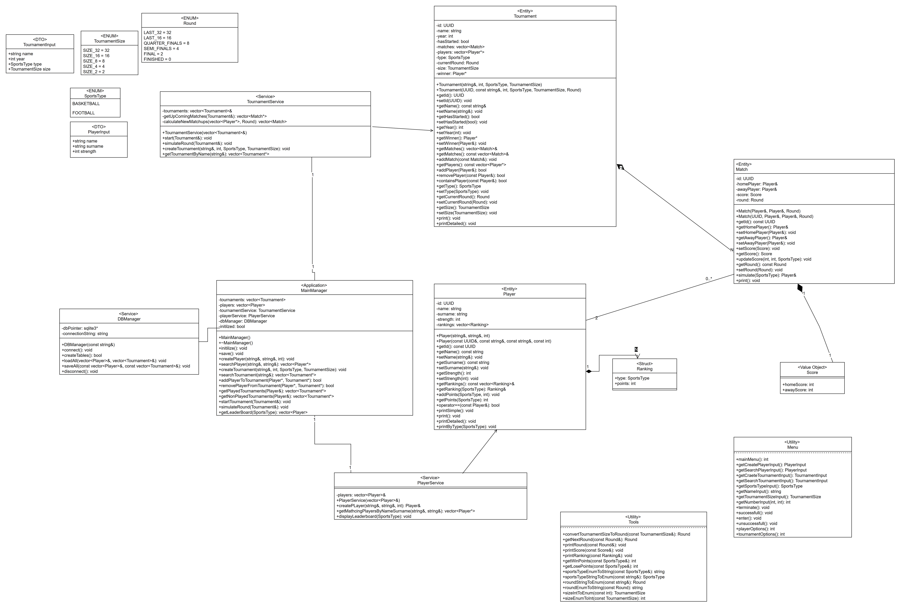
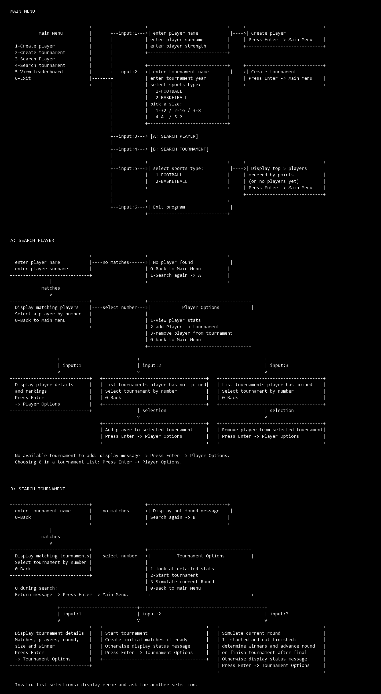

# MatchForge

A tournament management app built as a personal project to learn C++,
object-oriented programming, Qt, and SQLite.

## Features

- Create and search players and tournaments
- Add and remove players from tournaments
- Simulate matches and tournament rounds
- View player rankings
- Save and load data using SQLite

## Technologies

C++20, Qt Widgets, SQLite, CMake, and Boost.UUID.

## Diagrams

### Class diagram

[Open full-size UML](assets/diagrams/MatchForgeDDD.png) · [Editable draw.io file](assets/diagrams/MatchForgeDDD.drawio)

### Menu flow

The original console design shows how players and tournaments are created, searched, and managed. The current app uses Qt Widgets.

[Open full-size menu flow](assets/diagrams/menu-flow.png)
