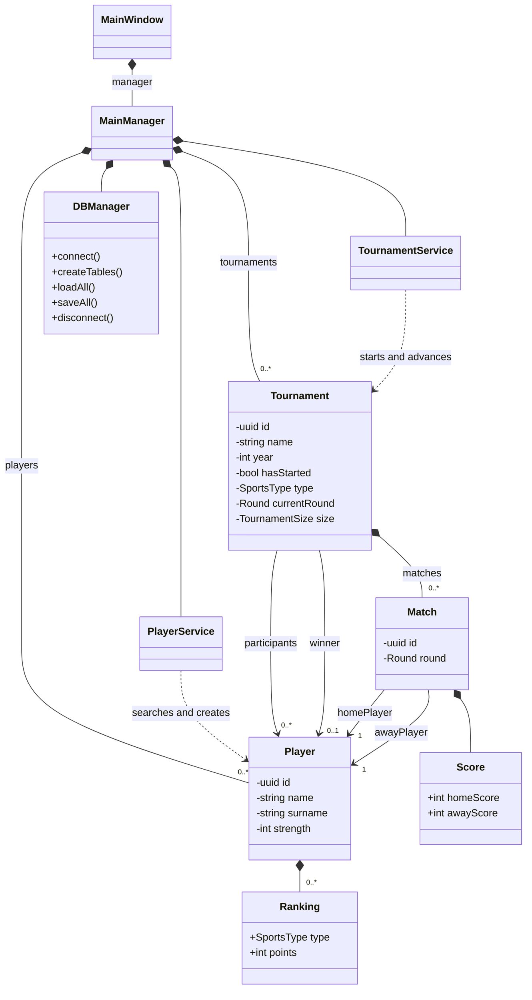

# Class diagram

The Qt main window owns a single manager. Both services work with the collections owned by that manager.

A filled diamond marks ownership. A tournament stores its participants as `std::vector<Player*>` and its winner as a nullable `Player*`. Each match holds two player references. Scores and rankings are stored by value.

[Browse the C++ declarations](../../include)
