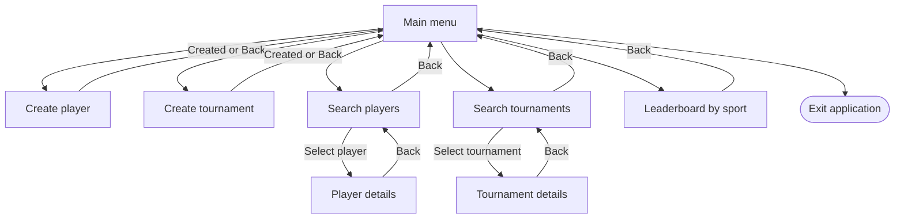

# Menu flow

After initialization, the Qt main window opens the main menu. Each box below represents a screen or the exit action.

- **Player details.** View player statistics, add the player to a tournament, or remove them from one.
- **Tournament details.** View tournament statistics, start the tournament, or simulate the current round.
- **Leaderboard.** Switch between football and basketball to refresh the rankings on the same screen.

[Browse the Qt navigation code](../../ui/MainWindow.cpp)
